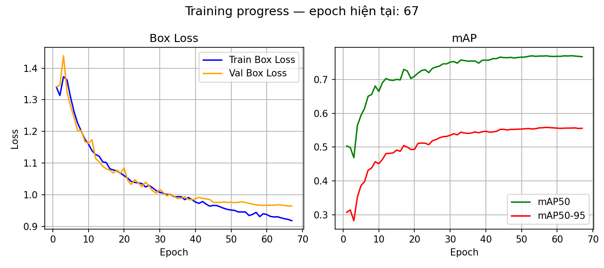
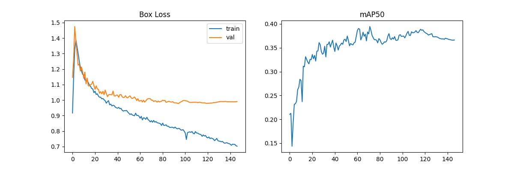

# Real-time Vietnamese Traffic Detection
### Yolov11s + EasyOCR | PyQt5 UI | Docker Deployment


**A real-time Vietnamese traffic sign detection and classification system built on YOLOv11s,
fine-tuned on a custom merged dataset of ~16,000 images across 32 classes.**

- Demo Video:
[](https://youtu.be/6wpSoVZwCko)
- Results: 

- Architecture:


---

## Overview

This project detects and classifies **32 Vietnamese traffic signs** in real-time using a fine-tuned YOLOv11s model, enhanced with EasyOCR to accurately read speed limit values. The system achieves **50–60 FPS** on an NVIDIA RTX 4050 GPU with a clean PyQt5 desktop interface while using camera.

> Built as a solo end-to-end Computer Vision project — from data collection and labeling to model training, UI development, and Docker deployment.

---

## Key Features

- **Real-time Detection** — 50–80 FPS on GPU, ~17 FPS on CPU
- **OCR Integration** — EasyOCR reads speed limit numbers directly from signs
- **32 Vietnamese Traffic Sign Classes** — covers prohibitory, warning, and mandatory signs
- **PyQt5 Desktop UI** — live video feed with detection log, FPS counter, confidence slider
- **Dual Input Support** — webcam or video file via file picker
- **Docker Deployment** — GPU-accelerated container with X11 display forwarding
- **Horizontal Flip Disabled** (`fliplr=0.0`) — preserves directional sign semantics

---

## Results

| Metric | Value                                |
|--------|--------------------------------------|
| **mAP@50** | 0.78 (YOLO only) → improved with OCR |
| **FPS (GPU)** | 50–80 FPS on RTX 4050                |
| **FPS (Video)** | 70–80 FPS                            |
| **Classes** | 32 Vietnamese traffic signs          |
| **Model Size** | 54.4 MB (YOLOv11s)                   |
| **Input Resolution** | 640×640                              |

### Speed Limit Detection
Speed limit signs (class `Gioi han toc do`) were the most challenging class due to visual similarity between values (30/40/50/60/80/100/120). Integrating **EasyOCR** post-detection significantly reduced misclassification.

---

## Dataset

| Source                                   | Images      | Notes                  |
|------------------------------------------|-------------|------------------------|
| Kaggle VN Traffic Signs                  | ~3,000      | 52 original classes    |
| zalo_traffic_sign dataset (self-labeled) | ~5,000      | Extended to 72 classes |
| **Merged & cleaned & augmented**         | **~16,000** | **32 final classes**   |

**Data Engineering challenges solved:**
- **Class ID remapping** between two incompatible dataset formats
- **Removed** greyscale, flip augmentation (broke color-based detection)
- **Merged sub-classes** that have same meaning
- **Excluded classes** with < 40 instances
- **Implement selective augment** with low quantity signs to reduce class imbalance
---

## Training Configuration

```python
data=data, name=name, epochs=200, imgsz=640, batch=16, amp=True,
device=0, hsv_h=0.015, hsv_s=0.7, hsv_v=0.4, mixup=0.1, copy_paste=0.1,
mosaic=1.0, scale=0.5, fliplr=0.0, close_mosaic=30, workers=4, patience=50,
dropout=0.2, resume=False, weight_decay=0.0005
```

---

## Quick Start

### Option 1 — Docker (Recommended)

**Requirements:** Docker Desktop + NVIDIA Container Toolkit + VcXsrv (Windows)

```bash
# Clone repo
git clone https://github.com/Secret350/Real-time-Traffic-Objects-Detection.git
cd Real-time-Traffic-Objects-Detection

# Copy model weights
cp src/runs/detect/yolo11_vntraffic_merged_32classes_dataset-4/weights/best.pt

# Run with GPU
.\run_docker.bat

# Run with CPU fallback
.\run_docker.bat cpu
```

### Option 2 — Local Python

```bash
# Clone repo
git clone https://github.com/Secret350/Real-time-Traffic-Objects-Detection.git
cd Real-time-Traffic-Objects-Detection

# Create virtual environment
python -m venv .venv
.venv\Scripts\activate

# Install dependencies
pip install -r requirements.txt

# Copy model weights to models
# Then run
python ui_design.py
```

---

## Hardware Requirements

| Component | Minimum | Used in project |
|-----------|---------|--------------|
| GPU | Any NVIDIA (CUDA) | RTX 4050 6GB |
| RAM | 8 GB | 32 GB        |
| Storage | 10 GB | NVMe SSD     |
| Python | 3.10+ | 3.11         |

> CPU mode is supported but FPS will be significantly lower (~10–15 FPS).
> 
---

## Dependencies

| Library | Purpose |
|---------|---------|
| `ultralytics` | YOLOv11s model |
| `easyocr` | Speed limit OCR |
| `PyQt5` | Desktop GUI |
| `opencv-python` | Video processing |
| `torch` + CUDA | GPU inference |

---

## Key Technical Decisions

**Why `fliplr=0.0`?**
Vietnamese traffic signs for left/right turns have directional meaning. YOLO's default horizontal flip augmentation (0.5) would teach the model that a "turn left" sign is the same as "turn right" — corrupting the entire directional class.

**Why FrameGrabber thread?**
`cv2.VideoCapture.read()` blocks until the next frame arrives (~33ms at 30Hz webcam). Running inference on the same thread would cap FPS at 30. Separating capture into a dedicated thread allows inference to run freely at GPU speed.

**Why EasyOCR for speed signs?**
Speed limit signs share identical circular red borders — the only difference is the number inside. YOLO alone misclassified 30/50/60/80 km/h signs. OCR on the cropped detection region resolves this with high accuracy.

**Why selective augmentation?**
- Some classes are not too few to be eliminated, but also not enough to train effectively due to insufficient numbers, causing an imbalance between classes. We will use selective agmentation to increase the diversity and number of classes.
- Different between train with selective augmentation and without selective augmentation
  + Selective Augmentation
   
  + Without Selective Augmentation - TrainLoss: ~1.03 - ValLoss: ~0.7
  

---

## Training Progress

*mAP@50 improvement across dataset iterations:*

| Iteration                                                    | Dataset Size | mAP@50                 |
|--------------------------------------------------------------|--------------|------------------------|
| + Kaggle data                                                | ~4,000 imgs  | ~0.62                  |
| + Merged dataset & Self-labeled<br/> | ~16,000 imgs | ~0.37 (Overfit)        |
| + Merged dataset & Self-labeled<br/>& Selective Augmentation | ~16,000 imgs | ~0.78                  |
| + OCR pipeline                                               | ~16,000 imgs | **~0.85+** (effective) |

---

## Author

**Nguyễn Đức Minh Trí**
Robotics & AI Student — Hanoi University of Industry (HaUI)

[](https://github.com/Secret350)

---

## License

This project is licensed under the MIT License — see the [LICENSE](LICENSE) file for details.

